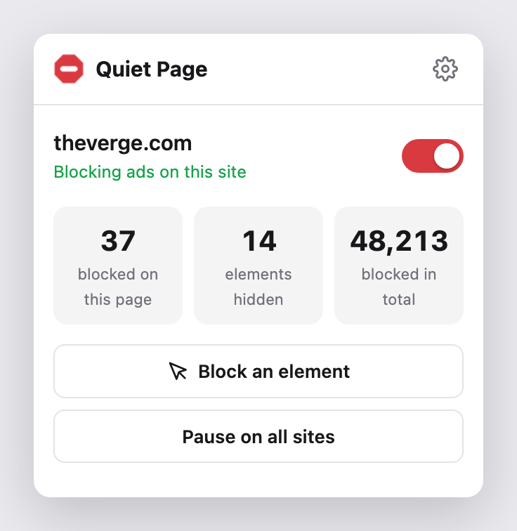
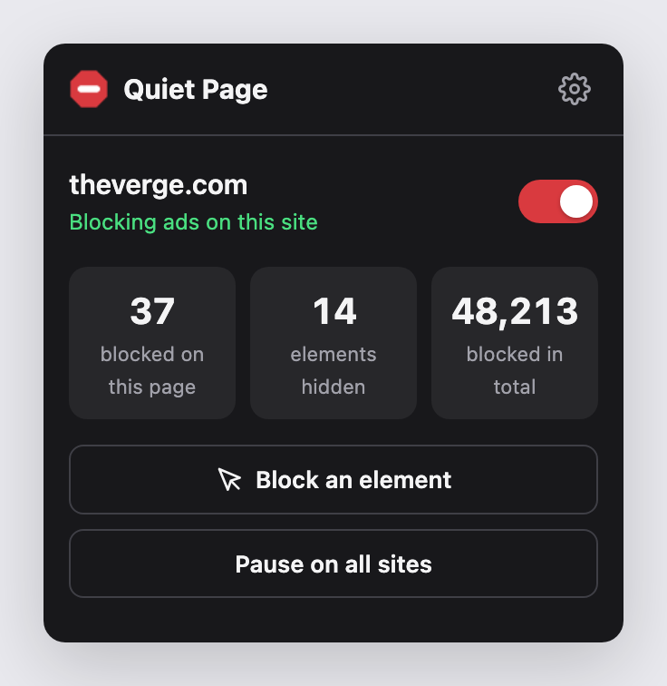
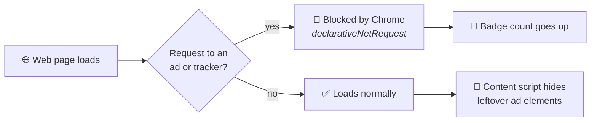
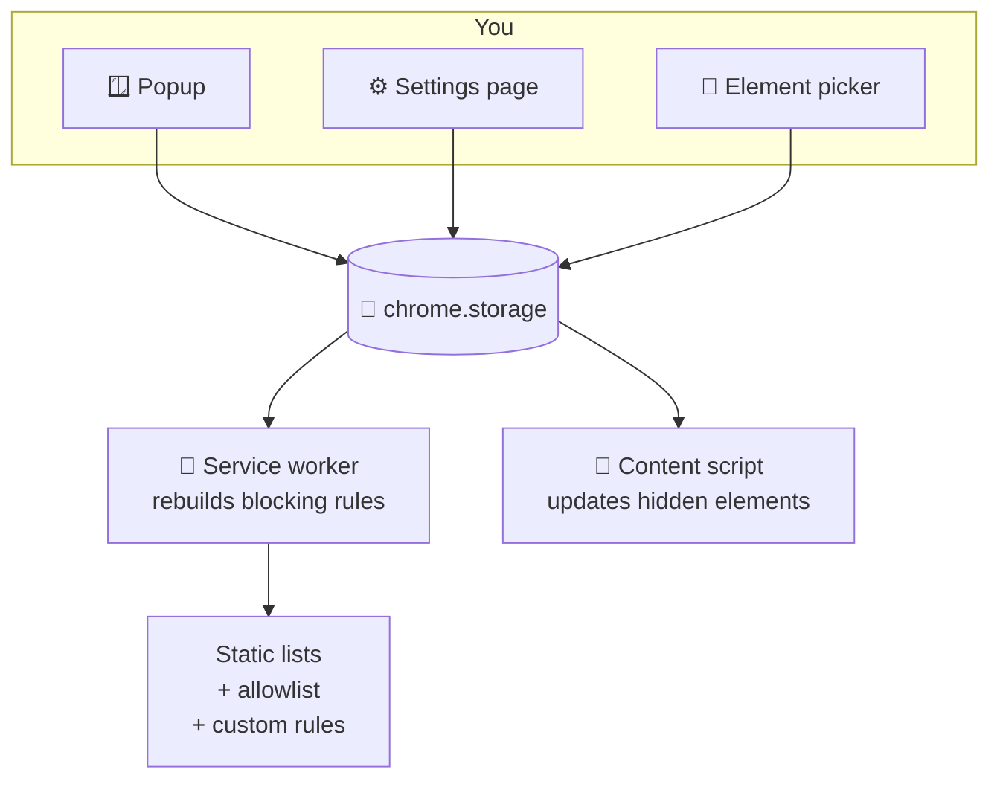
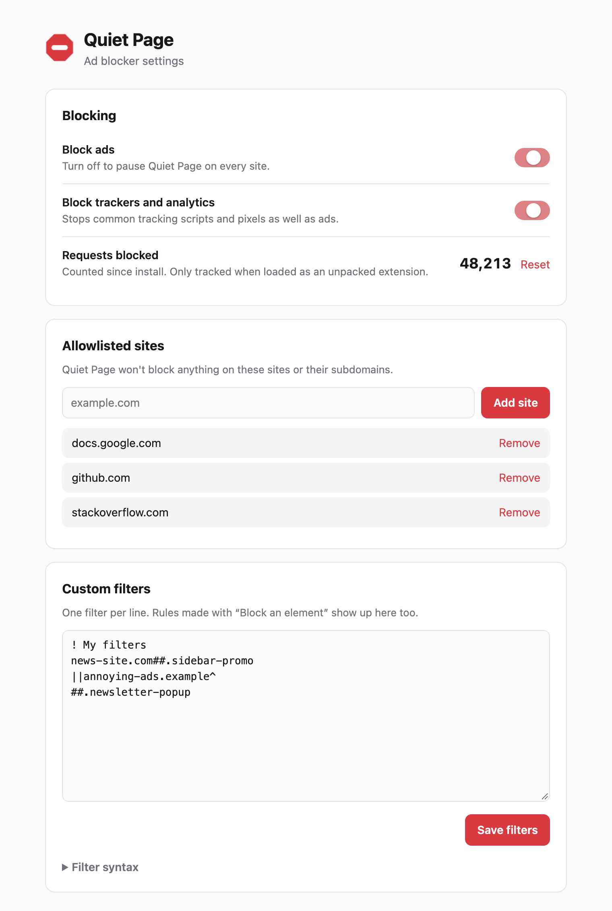

<div align="center">


# Quiet Page

**A lightweight ad blocker for Chrome that blocks ads, pop-ups and trackers.**



&nbsp;&nbsp;


</div>

---

## ✨ Features

| | Feature | What it does |
|---|---|---|
| 🛑 | **Network blocking** | Stops requests to about 130 ad and tracker domains before they load |
| 🧹 | **Element hiding** | Hides leftover ad boxes, sponsored widgets and empty ad slots |
| ▶️ | **YouTube ad skipping** | Mutes and skips video ads automatically |
| 🎚️ | **Per-site switch** | Turn blocking off for one site with a single click |
| 🎯 | **Block an element** | Point at anything on a page and click to hide it from then on |
| 🔢 | **Live counter** | Shows on the toolbar icon how many requests were blocked on the page |
| ✍️ | **Custom filters** | Add your own rules in AdBlock-style syntax |
| 🌗 | **Light and dark mode** | Follows your system theme |

---

## 🚀 Install

> Quiet Page isn't on the Chrome Web Store, so you load it in developer mode. It takes about 30 seconds.

```text
1. Download this repo   →  Code ▸ Download ZIP (and unzip), or git clone
2. Open Chrome          →  chrome://extensions
3. Turn on              →  "Developer mode" (top-right toggle)
4. Click                →  "Load unpacked" and select the project folder
5. Pin it               →  🧩 puzzle-piece menu ▸ 📌 Quiet Page
```

```sh
git clone https://github.com/saimmehmood/quiet-page-adblock.git
```

Tabs that were already open need a reload before element hiding starts working on them.

---

## 🧠 How it works

Quiet Page blocks ads in two layers. Chrome itself blocks the network requests. A small script on each page then hides whatever ad space is left over.



Your settings drive both layers:



---

## ⚙️ Settings

<div align="center">

</div>

### Custom filter syntax

| Filter | Meaning |
|---|---|
| `! note` | Comment (ignored) |
| `ads.example.com` | Block every request to this domain and its subdomains |
| `\|\|ads.example.com^` | Same thing, written AdBlock-style |
| `\|\|example.com/banners/*` | Block requests whose URL matches the pattern |
| `##.promo-box` | Hide elements matching a CSS selector on **every** site |
| `example.com##.promo-box` | Hide elements on **one** site (separate several hosts with commas) |

---

## 📁 Project structure

```text
quiet-page-adblock/
├── manifest.json          ← extension manifest (MV3)
├── background.js          ← service worker: rules, badge, icon state, stats
├── lib/common.js          ← shared settings and filter parsing
├── rules/
│   ├── ads.json           ← ad blocklist (generated)
│   └── trackers.json      ← tracker blocklist (generated)
├── content/
│   ├── cosmetic.js        ← hides ad elements and skips YouTube ads
│   └── picker.js          ← "Block an element" tool
├── popup/                 ← toolbar popup
├── options/               ← settings page
├── icons/                 ← toolbar icons (red = on, grey = off)
└── tools/
    ├── build_rules.py     ← generates rules/*.json
    └── make_icons.py      ← draws the icons
```

---

## 🛠️ Development

**Add or remove blocked domains.** Edit the lists in `tools/build_rules.py`, then run:

```sh
python3 tools/build_rules.py
```

**Redraw the icons:**

```sh
python3 tools/make_icons.py
```

After either change, click ↻ on the extension card at `chrome://extensions`.

No build step, bundler or npm packages are needed. Both scripts use only the Python standard library.

---

## ⚠️ Limitations

- **Smaller lists than big ad blockers.** The bundled lists are short next to EasyList's tens of thousands of rules, so some ads get through. For wider coverage, convert EasyList with [`abp2dnr`](https://gitlab.com/eyeo/adblockplus/abc/abp2dnr) and add it as another ruleset in `manifest.json`.
- **YouTube ad skipping is best effort.** YouTube changes its pages often, so skipping may stop working from time to time.
- **The lifetime counter only works in developer mode.** Chrome only reports the data it needs to unpacked extensions. The per-page badge count works everywhere.

---

<div align="center">
<sub>Built with vanilla JavaScript and Chrome's <code>declarativeNetRequest</code> API.</sub>
</div>
